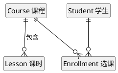
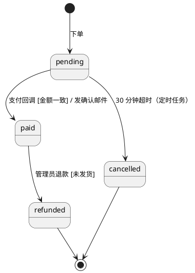
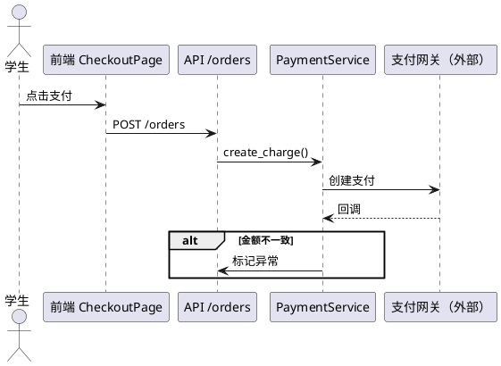

# Diagrams and prototypes

A diagram earns its place when it shows structure prose would need a
paragraph for. One idea per diagram; split rather than crowd. Names in
diagrams match the headings in the spec. Every element comes from cited code;
the prose next to the diagram carries the links.

## PlantUML

Sources in `diagrams/`, rendered locally by `render_diagrams.py`. Always start
with `@startuml <name>` and end with `@enduml`. Keep the default theme; add
`skinparam defaultFontName "PingFang SC"` when labels are Chinese so the SVG
renders them.

### ER (relations)



Entities only, or a few defining fields when they explain a relation. Crow's
foot notation: `||` exactly one, `o|` zero or one, `}o` zero or many, `}|`
one or many.

### State (lifecycles)



Label every transition `trigger [guard] / effect`, with the guard and effect
only when they exist. States no code enters or leaves: draw them, and
`note` them.

### Sequence (flows)



Participants are real modules, services or external systems; label messages
with the endpoint or function. Use `alt`/`opt` only for branches that change
the outcome. External systems are marked as outside the repository.

### Activity (decision-heavy flows)

Use an activity diagram instead of a sequence diagram when the point is the
branching logic rather than who calls whom.

## Prototypes: ASCII first, SVG after confirmation

### ASCII draft

Settle logic and copy before drawing anything. In a code block, under the
prototype marker:

```
<!-- spec:prototype id=refund-request status=pending -->
┌───────────────────────────────────────┐
│ ← 订单 #A1023          申请退款        │
├───────────────────────────────────────┤
│ 可退金额  ¥128.00                      │  ① 实付金额，见业务决定·退款上限
│ 退款原因  [ 请选择           ▾ ]       │
│ 说明      [                      ]     │
│                                       │
│            [ 提交申请 ]                │  ② POST /orders/{id}/refunds
└───────────────────────────────────────┘
① ② 标注：数据来源与动作，各一行
状态：提交中按钮置灰；失败时顶部红条显示后端错误文案
```

- Box-drawing characters, fixed-width alignment.
- Real copy: reuse the product's existing wording and terms.
- Numbered notes for where data comes from and what each action calls.
- Empty, loading and error states as one line each when they differ.
- Show it to the user and get explicit confirmation on logic and wording.

### SVG prototype

Only after confirmation, `prototypes/<id>.svg`, embedded under the ASCII
draft, and the marker changes to `status=confirmed`.

- Hand-written SVG, low fidelity: greys, one accent colour for the primary
  action, no images or external references, no scripts.
- `viewBox` 1280 wide for desktop pages, 390 for mobile; height as needed.
- Same copy and numbered notes as the confirmed ASCII draft; numbers in
  circles beside the elements, legend below the frame.
- Text in `font-family="-apple-system, 'PingFang SC', 'Segoe UI', sans-serif"`.
- If the draft changes after confirmation, the marker goes back to
  `pending` and the SVG is deleted until the new draft is confirmed.
